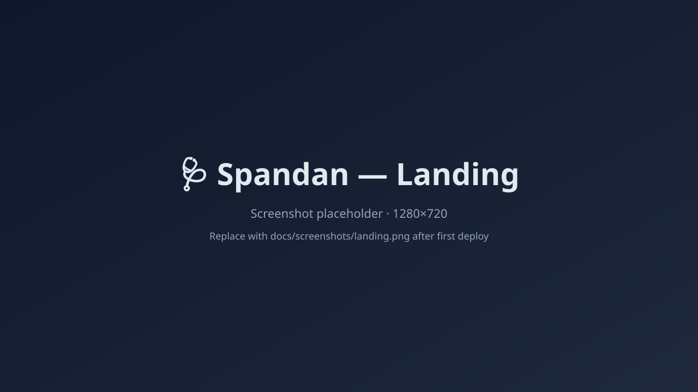
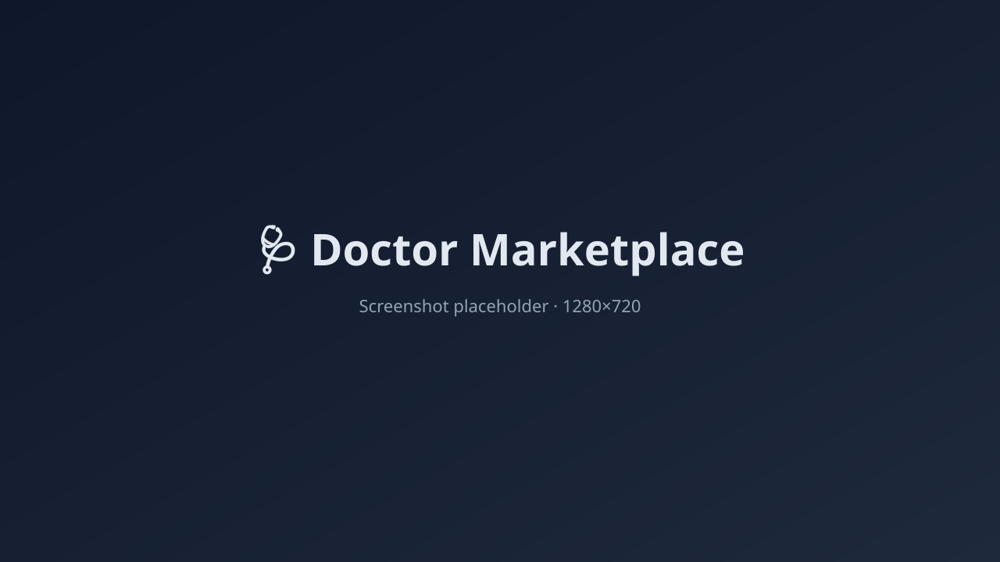
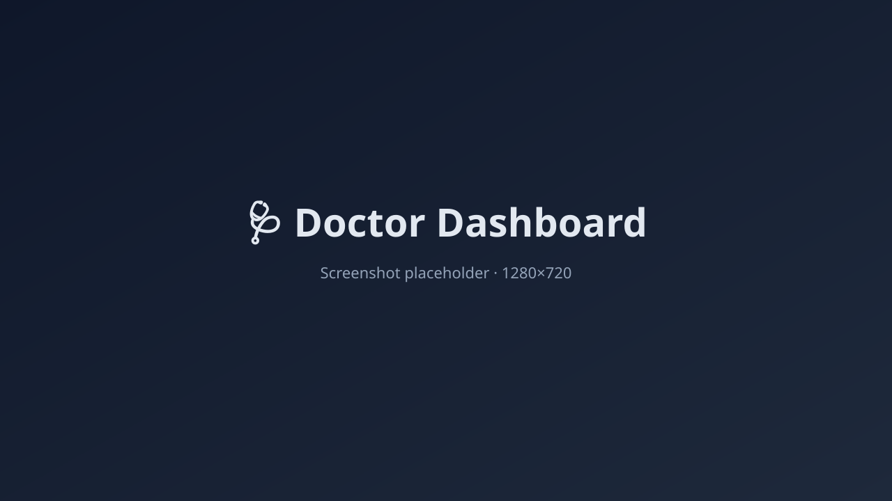
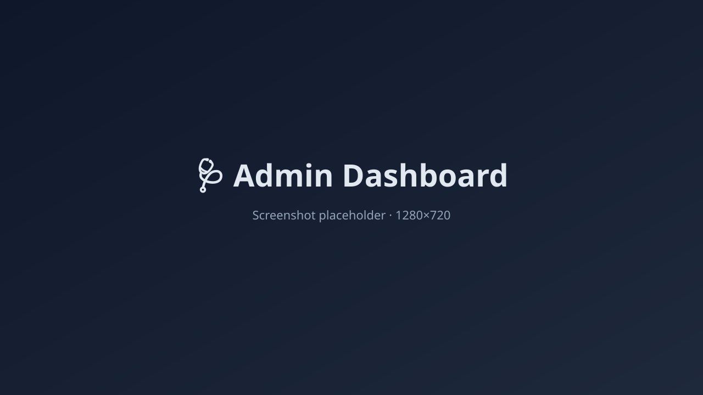
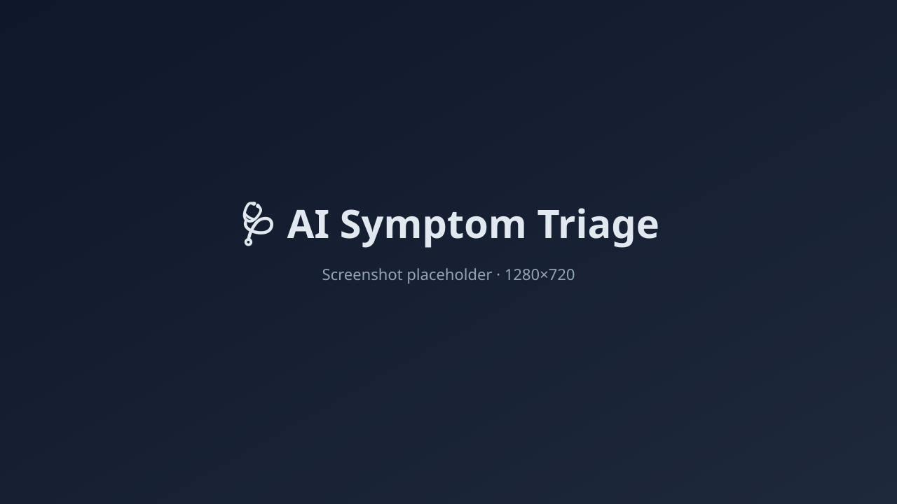
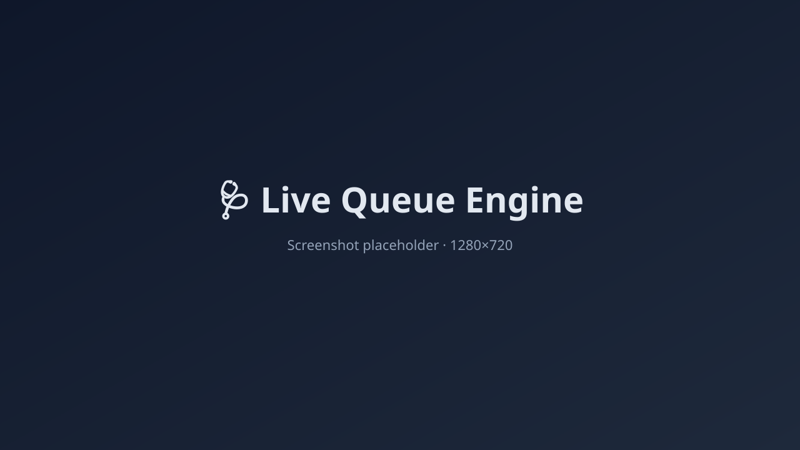
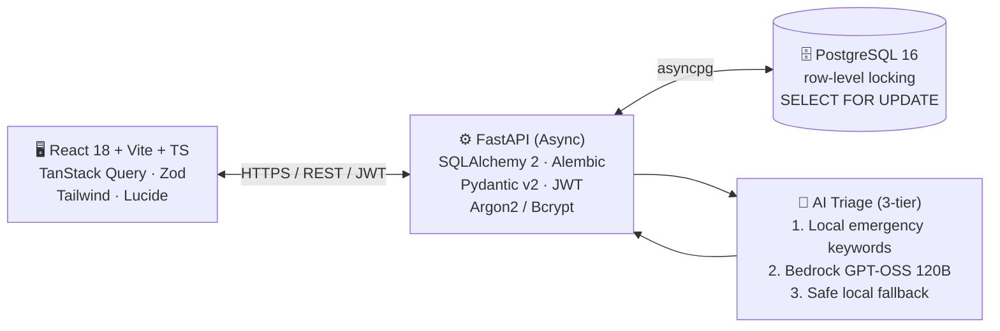

<div align="center">

# 🩺 Spandan

### AI-Assisted Appointment Booking & Private Chamber Management System — verified doctors, multi-chamber scheduling, real-time queues, and safety-first AI triage for Bangladesh.

[](https://spandan.cuetinsights.dev)
[](./LICENSE)
[](https://react.dev)
[](https://www.typescriptlang.org)
[](https://vite.dev)
[](https://fastapi.tiangolo.com)
[](https://www.postgresql.org)
[](https://tailwindcss.com)
[](https://aws.amazon.com/bedrock/)
[](./docker-compose.yml)

<br />

Spandan is a production-style healthcare platform that brings **patients, doctors, assistants, and admins** into one secure system — with AI-assisted symptom triage, role-based dashboards, and an end-to-end queue engine with no double-booking.

[🚀 Live Website](https://spandan.cuetinsights.dev) · [🐛 Report Bug](https://github.com/sakawatkabir13/spandan/issues) · [✨ Request Feature](https://github.com/sakawatkabir13/spandan/issues)

</div>

---

## ✨ Why Spandan?

Booking a private chamber consultation in Bangladesh today means phone calls, paper registers, and zero visibility into queue times. **Spandan** digitises the entire flow — from **verified doctor profiles** and **multi-chamber scheduling** to a **real-time queue engine** with atomic serial allocation — and adds a **safety-first AI triage** layer that suggests which specialty to consult based on symptoms.

> ⚠️ **Spandan's AI is informational only.** It does **not** diagnose, prescribe, or replace professional medical advice. In an emergency, call **999** (Bangladesh).

---

## 📑 Table of Contents

1. [✨ Features](#-features)
2. [🖼️ Screenshots](#-screenshots)
3. [🏗️ Architecture](#-architecture)
4. [🧱 Tech Stack](#-tech-stack)
5. [🚀 Quick Start](#-quick-start)
6. [🧪 Available Scripts](#-available-scripts)
7. [📁 Project Structure](#-project-structure)
8. [🔐 Environment Variables](#-environment-variables)
9. [🐳 Docker Deployment](#-docker-deployment)
10. [🛡️ Medical Disclaimer](#-medical-disclaimer)
11. [🗺️ Extended workflows](#-extended-workflows)
12. [🤝 Contributing](#-contributing)
13. [🛡️ Security](#-security)
14. [📄 License](#-license)
15. [🙏 Acknowledgements](#-acknowledgements)
16. [👥 Contributors](#-contributors)

---

## ✨ Features

### 🧑‍⚕️ For Patients

- 🩺 Browse a verified directory of doctors with specialty and chamber filters
- 📅 Book appointments online with **live queue serial** allocation
- ✅ Confirm or cancel appointments and view doctor profile photos
- 🧾 Full **appointment history** with per-visit status tracking
- 🤖 **AI symptom triage** that recommends which specialty to consult
- 🔐 Email OTP verification and password recovery
- 📋 Medical history, encrypted reports, and patient-controlled sharing with eligible booked doctors
- 👪 Separate family medical charts, private report previews, and doctor-access history
- 🧭 One appointment page for queue tracking, payments, shared reports, and follow-up
- 💚 Saved doctors and time-limited offers for released waitlist places
- 💳 Hosted checkout, payment status, and receipts
- 📱 Fully responsive across desktop, tablet, and mobile

### 👨‍⚕️ For Doctors

- 🧑‍💼 Dedicated **Doctor Dashboard** for schedules, chambers, and patient queue
- ➕ Create individual or recurring schedules with overlap protection
- 📈 Track today's queue, active serials, and consultation history
- 🏥 Manage **multiple chambers** with independent schedules and fees
- 📋 Review patient-shared medical history and reports before eligible consultations
- 🗓️ Today's workspace with patient preparation and unresolved visit review
- 📝 Review and publish visit summaries, prescriptions, and follow-up instructions

### 🧑‍💼 For Assistants

- 🎟️ Manage the **walk-in (offline) queue** for the assigned doctor/chamber
- ➡️ Mark serials as *served*, *skipped*, or *delayed* in real time
- 🔄 Move patients through check-in, waiting, skipped, in-room, completed, and no-show states

### 🛡️ For Admins

- 🧭 Centralized **Admin Dashboard** for moderation
- ✅ Approve or reject doctor verification
- 👀 Manage user access and inspect protected audit logs

### 🔐 Platform-Wide

- 🔑 Email + password auth with **JWT access + refresh tokens** and **Argon2/Bcrypt** hashing
- 🔁 Logout and password changes revoke existing access and refresh tokens
- 📱 Device session management, sign-in activity, refresh-token reuse protection, and MFA recovery codes
- 🏭 Separate development and production Docker stacks with health checks
- 🧪 Backend tests with **Pytest** + frontend tests with **Vitest** + **Testing Library**
- 🎨 Theming and design tokens with **Tailwind CSS**
- 🔒 Strict Postgres constraints and row-level locking (`SELECT FOR UPDATE`) — zero double-booking

---

## 🖼️ Screenshots

> Placeholders ship as `.svg` files in `docs/screenshots/`. Replace with real `.png` (1280×720) screenshots after the first deploy.

| Landing | Marketplace |
| :---: | :---: |
|  |  |

| Doctor Dashboard | Admin Dashboard |
| :---: | :---: |
|  |  |

| AI Triage | Live Queue |
| :---: | :---: |
|  |  |

---

## 🏗️ Architecture



**Key flows**

- **Auth & RBAC** — JWT access + refresh tokens; Argon2/Bcrypt hashing; four role-based portals (Patient, Doctor, Assistant, Admin).
- **Queue engine** — PostgreSQL row-level locking (`SELECT FOR UPDATE`) guarantees **no double-booking** between online and walk-in serials.
- **AI triage** — local emergency keyword screening → Amazon Bedrock `openai.gpt-oss-120b-1:0` strict structured output → safe fallback when the provider is unavailable.
- **Doctor verification** — doctors only become publicly visible after admin approval (`PENDING → APPROVED / REJECTED / SUSPENDED`).

For auth flow, queue locking, state machines, the ERD, and deployment topology, see [`docs/ARCHITECTURE.md`](./docs/ARCHITECTURE.md).

---

## 🧱 Tech Stack

### Frontend

| Layer | Technology |
| --- | --- |
| Framework | **React 18** |
| Language | **TypeScript 5** |
| Build tool | **Vite 8** |
| Styling | **Tailwind CSS 4** |
| Routing | **React Router 7** |
| Forms | **React Hook Form** + **Zod** resolvers |
| Data fetching | **TanStack Query v5** |
| Icons | **Lucide React** |

### Backend

| Layer | Technology |
| --- | --- |
| Runtime | **Python 3.11+** |
| Framework | **FastAPI 0.110** (async) |
| ORM | **SQLAlchemy 2** with `asyncpg` |
| Validation | **Pydantic v2** |
| Migrations | **Alembic** |
| Auth | **JWT** (access + refresh) · **Argon2 / Bcrypt** hashing |
| AI | **Amazon Bedrock** — GPT-OSS 120B triage; GPT-OSS 120B support |

### Database & Tooling

| Layer | Technology |
| --- | --- |
| Database | **PostgreSQL 16** (row-level locking) |
| Backend tests | **Pytest** + `pytest-asyncio` + `aiosqlite` |
| Backend lint | **Ruff** |
| Frontend tests | **Vitest** + **Testing Library** + **jsdom** |
| Frontend checks | **TypeScript (`tsc --noEmit`)** |
| Orchestration | **Docker Compose** (db + backend + frontend) |

---

## 🚀 Quick Start

### Prerequisites

- **Docker** & Docker Compose **v2.x+**

### 1. Clone the repository

```bash
git clone https://github.com/sakawatkabir13/spandan.git
cd spandan
```

### 2. Configure environment

```bash
cp .env.example .env
```

> 🔑 Set `AI_ENABLED=true` and `AWS_BEARER_TOKEN_BEDROCK` in the private `.env` for Bedrock inference. Production can use an EC2 IAM role instead. Without configured inference, triage retains its **local fallback engine**.

### 3. Launch the stack

```bash
docker compose up --build -d
```

On first boot the backend will:

1. Wait for Postgres to be healthy.
2. Run `alembic upgrade head` (idempotent migrations).
3. Start Uvicorn with hot-reload.

Accounts are not created automatically. Register through the application; email verification requires SMTP credentials in the private `.env` file. Gmail uses an app password without spaces. Server credentials are passed only to the backend and must never use the `VITE_` prefix.

### 4. Open the apps

| App | URL |
| --- | --- |
| 🖥️ Frontend | http://localhost:5173 |
| 📘 Swagger UI | http://localhost:8000/docs |
| 📕 ReDoc | http://localhost:8000/redoc |
| 🌐 Production | https://spandan.cuetinsights.dev |

---

## 🧪 Available Scripts

### Docker commands (development)

| Command | Description |
|---|---|
| `docker compose up --build -d` | Build and start the development services |
| `docker compose down` | Stop the development services |
| `docker compose restart` | Restart the development services |
| `docker compose logs -f` | Follow service logs |
| `docker compose exec backend alembic upgrade head` | Apply database migrations |
| `docker compose exec backend python -m scripts.import_directory` | Import reviewed public hospital listings |
| `docker compose exec backend pytest -q` | Run backend tests |


### Backend (inside `backend/`)

```bash
ruff check .              # lint
pytest -v                 # run tests
alembic upgrade head      # apply migrations
uvicorn app.main:app --reload
```

### Frontend (inside `frontend/`)

| Script | Description |
| --- | --- |
| `npm run dev` | Start the Vite dev server with HMR |
| `npm run build` | Production build to `dist/` |
| `npm run preview` | Preview the production build locally |
| `npm run lint` | Run TypeScript validation without emitting files |
| `npm run test` | Run the Vitest suite once |

---

## 📁 Project Structure

```
spandan/
├── backend/                 # FastAPI service
│   ├── app/
│   │   ├── api/             # routes & dependencies
│   │   │   ├── dependencies/
│   │   │   └── routes/
│   │   ├── core/            # config, security, exceptions
│   │   ├── db/              # SQLAlchemy base, async session
│   │   ├── models/          # ORM models
│   │   ├── repositories/    # data-access layer
│   │   ├── schemas/         # Pydantic DTOs
│   │   └── services/        # business logic
│   ├── alembic/             # migrations
│   ├── scripts/             # seed data
│   ├── tests/               # Pytest suite
│   ├── Dockerfile
│   └── pyproject.toml
├── frontend/                # Vite + React + TS
│   ├── src/
│   │   ├── api/             # axios client
│   │   ├── components/      # common, layout
│   │   ├── context/         # AuthContext
│   │   ├── pages/           # auth, dashboard, doctors, ai
│   │   └── types/
│   ├── tests/               # Vitest setup
│   ├── Dockerfile
│   └── package.json
├── .github/
│   ├── ISSUE_TEMPLATE/      # bug_report.yml, feature_request.yml
│   └── workflows/ci.yml     # GitHub Actions CI
├── ops/                     # Release, rollback, backups, and monitoring
├── docker-compose.yml       # Local development
├── docker-compose.prod.yml  # Production
├── .env.example
├── .env.production.example
├── LICENSE
├── docs/
│   ├── ARCHITECTURE.md
│   └── screenshots/
└── README.md
```

---

## 🔐 Environment Variables

Local configuration uses `.env`; production Compose explicitly loads `.env.production`. Both private files are Git-ignored. Copy the matching example template and keep server-side secrets out of Git.

| Variable | Required | Description |
| --- | :---: | --- |
| `APP_ENV` | ✅ | `development` \| `staging` \| `production` |
| `APP_NAME` | ✅ | Service name (default: `Spandan`) |
| `APP_TIMEZONE` | ✅ | IANA timezone (default: `Asia/Dhaka`) |
| `DATABASE_URL` | ✅ | e.g. `postgresql+asyncpg://spandan:spandan@db:5432/spandan` |
| `JWT_SECRET_KEY` | ✅ | Private random signing secret; preserve any secret used to encrypt existing reports |
| `JWT_ALGORITHM` | ✅ | `HS256` (default) |
| `ACCESS_TOKEN_EXPIRE_MINUTES` | ✅ | Default `30` |
| `REFRESH_TOKEN_EXPIRE_DAYS` | ✅ | Default `7` |
| `FRONTEND_URL` | ✅ | e.g. `https://spandan.cuetinsights.dev` |
| `BACKEND_URL` | ✅ | e.g. `https://spandan.cuetinsights.dev` |
| `CORS_ORIGINS` | ✅ | Comma-separated allow-list |
| `AI_ENABLED` | ⚙️ | Enables configured Amazon Bedrock inference |
| `AWS_BEARER_TOKEN_BEDROCK` | ⚙️ | Development/initial deployment credential; use an IAM role when available |
| `AWS_REGION` | ⚙️ | Default `us-east-1` |
| `BEDROCK_TRIAGE_MODEL` | ⚙️ | Default `openai.gpt-oss-120b-1:0`, independent of chat |
| `UPLOAD_DIR` | ✅ | Server-side upload path (default `uploads`) |
| `MAX_UPLOAD_SIZE_MB` | ✅ | Default `5` |
| `EMERGENCY_CONTACT_NUMBER` | ✅ | Default `999` |

---

## 🐳 Docker Deployment

There are two independent stacks. Do not combine their Compose files.

| File | Purpose |
| --- | --- |
| `docker-compose.yml` | Local development with source hot reload |
| `docker-compose.prod.yml` | Production images, private services, health checks, bounded logs, and persistent storage |
| `.env.example` | Tracked template for local `.env` |
| `.env.production.example` | Tracked template for private production `.env.production` |

Actual environment files are private and excluded from Git. Example templates contain placeholders only. Keep credentials on the server and configure optional integrations through the matching template.

The production stack builds the frontend and backend, applies migrations, and checks service health. Deployment-specific networking, credentials, and maintenance settings belong in private operator configuration.

---

## 🛡️ Medical Disclaimer

1. **Not a medical device.** Spandan's AI Specialist Recommendation tool provides **general guidance only** based on user-entered symptoms. It **never** diagnoses illnesses or prescribes medication.
2. **Emergencies.** If you or someone near you is experiencing life-threatening symptoms (e.g., severe chest pain, difficulty breathing, stroke symptoms, severe bleeding), call **999** immediately or visit the nearest hospital emergency department.
3. **Consult a licensed professional.** Always verify recommendations with a registered doctor before making health decisions.

---

## 🗺️ Extended workflows

- In-app confirmations, queue alerts, cancellation notifications, and reminders; configurable SMTP email and Twilio SMS delivery.
- Atomic rescheduling, cancellation waitlists, staff walk-in intake, and family/dependent bookings.
- Cash recording, receipts, refunds, hosted Stripe sandbox checkout, signed webhooks, and provider-verified payment reconciliation. Test cards exercise the full flow without moving real funds.
- Expiring password recovery and contact verification, authenticator MFA, and security audit events.
- Doctor availability calendars, holiday closures, chamber/session editing, and recurring-series editing.
- Installable patient PWA with a generic offline page; patient and API data are never cached offline.
- Configurable video consultation rooms and authorized FHIR R4 Appointment export.
- Bengali labels for core patient flows, mobile layouts, and keyboard/accessibility improvements.
- Chamber analytics, operator status, health-data retention, and privacy export/deletion requests.

Email verification/recovery and hosted checkout require SMTP and Stripe credentials. Optional SMS, video, and off-site storage integrations require their own provider configuration. Appointment availability should be confirmed by the responsible chamber.

Have an idea? [Open a feature request](https://github.com/sakawatkabir13/spandan/issues/new?template=feature_request.yml).

---

## 🤝 Contributing

Open a focused pull request with relevant validation. CI checks backend/frontend tests, PostgreSQL migrations and concurrency, browser workflows, dependencies, and production containers.

---

## 🛡️ Security

Report suspected vulnerabilities privately to community.cuetinsights@gmail.com. Do not include passwords, API keys, patient information, or private environment files in issues or commits.

---

## 📄 License

This project is licensed under the **MIT License** — see the [`LICENSE`](./LICENSE) file for details.

© 2026 **Mohammad Sakawat Kabir**

---

## 🙏 Acknowledgements

- [FastAPI](https://fastapi.tiangolo.com/) & [SQLAlchemy](https://www.sqlalchemy.org/) — rock-solid async backend foundations.
- [Amazon Bedrock](https://aws.amazon.com/bedrock/) — inference for separately configured support and triage models.
- [TanStack](https://tanstack.com/), [Tailwind CSS](https://tailwindcss.com/), and the [Vite](https://vitejs.dev/) team — delightful frontend DX.
- [PostgreSQL](https://www.postgresql.org/) — the world's most advanced open-source database.
- The Bangladeshi doctor and patient community — this project exists to serve you.

---

## 👥 Contributors

<!-- ALL-CONTRIBUTORS-LIST:START -->

| Name | Role / Focus | GitHub |
| :--- | :--- | :---: |
| **Mohammad Sakawat Kabir** | Project lead & full-stack | [@sakawatkabir13](https://github.com/sakawatkabir13) |
| **Abdur Rashid Raj** | Frontend & patient flows | [@Asimpleman420](https://github.com/Asimpleman420) |
| **Olid Hussan Opu** | Auth, dashboards & admin flows | [@olid-opu](https://github.com/olid-opu) |
<!-- ALL-CONTRIBUTORS-LIST:END -->

Contributions can be proposed through GitHub issues and pull requests.

---

<div align="center">

⭐ **If you find this project useful, please consider giving it a star!** ⭐

Made with 💚 in 🇧🇩 Bangladesh by the [Spandan team](#-contributors)

</div>
